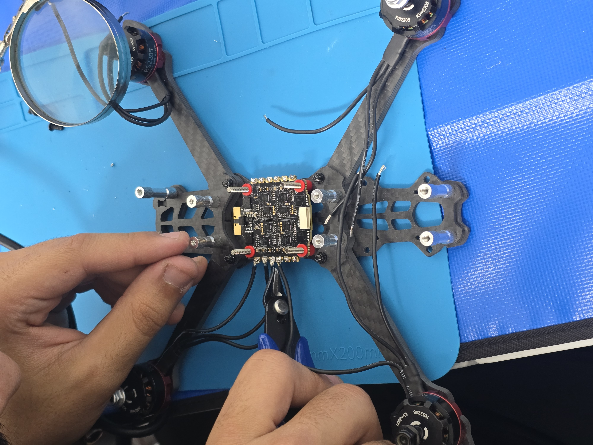
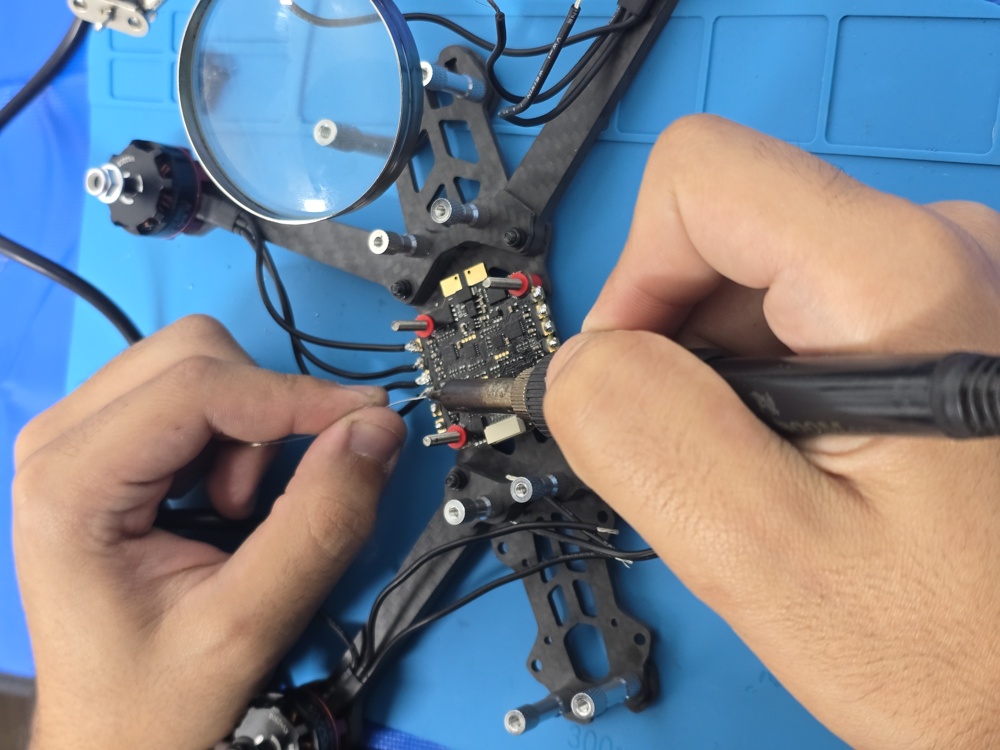
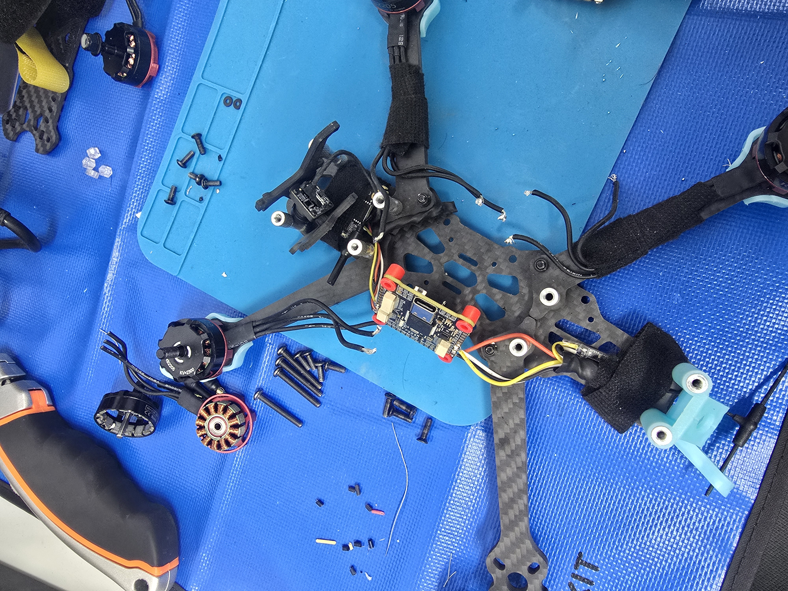
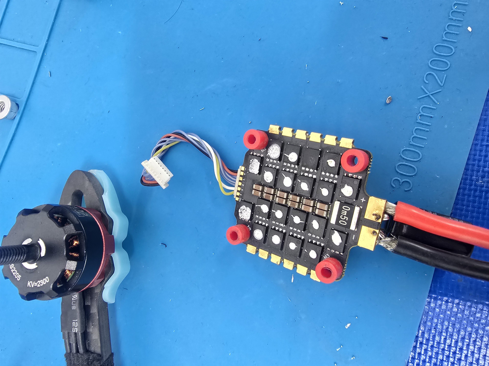
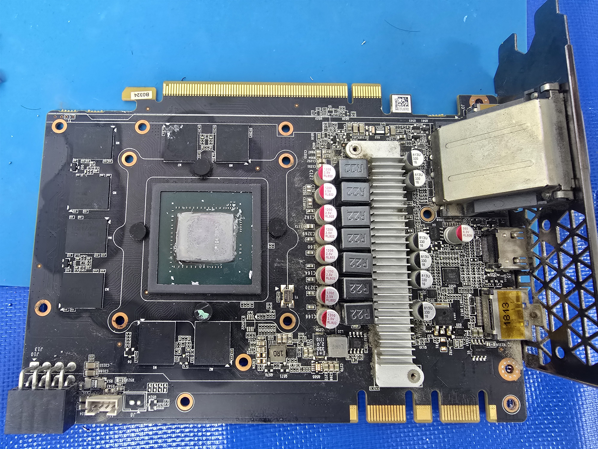
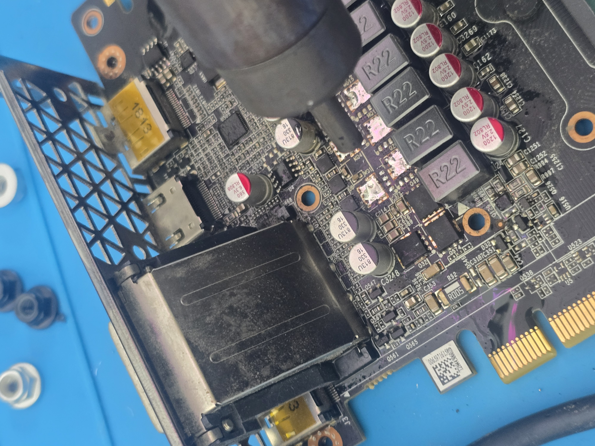

# FPV Drone — Build and Repair

> **Work in progress.** A personal FPV quadcopter project by **Adam Abu Toamy**.

[العربية](README_AR.md) · [Hardware register](docs/HARDWARE.md) · [Repair log](docs/REPAIR_LOG.md)

## Media gallery

**All supplied media: 6 original photos and 6 original recordings.** Every video below has its audio track removed. Video frames were copied without re-encoding. Large recordings are presented in numbered consecutive parts; all original video packets are retained.

### Photos

| Assembly and wiring | Build details |
| --- | --- |
|  |  |
|  |  |
|  |  |

### Videos — no audio

#### 01 · 20260903_074254.mp4

https://github.com/user-attachments/assets/339ed626-3194-44b6-aee0-c97dae2871ad

#### 02 · 20260903_074309.mp4

**Part 1 / 2**

https://github.com/user-attachments/assets/dee5e435-76dd-4034-8eb6-3bd4327793f6

**Part 2 / 2**

https://github.com/user-attachments/assets/13b7a4aa-8cb2-4dad-a182-b407af5a3976

#### 03 · 20260904_043352.mp4

**Part 1 / 2**

https://github.com/user-attachments/assets/8e3fc69a-f6c3-47dd-91f1-f4ea5fea364a

**Part 2 / 2**

https://github.com/user-attachments/assets/ee102eb8-1f78-4f44-8143-e631157153dc

#### 04 · 20260905_015915.mp4

https://github.com/user-attachments/assets/6bb4f98e-62a1-4b6c-a81d-266df31c4ae2

#### 05 · 20260906_021615.mp4

https://github.com/user-attachments/assets/21cfbd32-adca-454b-84b0-b1329708a2ee

#### 06 · 20260917_154932.mp4

https://github.com/user-attachments/assets/42ae3da9-a804-4ace-8616-e8e0ee8b7744

[Media inventory and processing verification](docs/MEDIA_SOURCES.md)

## Project and my work

I assembled and wired a 5-inch FPV drone, configured it with Betaflight, and worked through setup and electronics faults. After an initial flight ended in a hard landing, I investigated motor and ESC damage and reported the drone working again after an ESC repair. This is a historical milestone; the project remains in development.

My contribution covers assembly, wiring, soldering, configuration and fault diagnosis. Betaflight is third-party firmware, not a flight controller algorithm I wrote.

## Parts

| Component | Confirmed information / missing detail |
| --- | --- |
| Frame | Mark4, 5-inch |
| Battery | 4S LiPo; capacity and C rating not confirmed |
| ESC | 60 A; exact model/revision not confirmed |
| Motors | Brushless; current model and KV not confirmed |
| Propellers | 5-inch; exact model/pitch not confirmed |
| Radio link | ExpressLRS receiver and RadioMaster transmitter; exact models not confirmed |
| Flight controller | Used in the build; exact board and firmware target not confirmed |
| FPV system | Present in the recorded build; exact model not confirmed |
| Configuration / training software | Betaflight / Liftoff |

Unconfirmed shopping-list recommendations are not treated as installed components. See [hardware register](docs/HARDWARE.md).

## Difficulties and what happened

| Difficulty encountered | Recorded work / outcome |
| --- | --- |
| Sensor detection and firmware setup | Connection, voltage and firmware/configuration checks; connections were isolated during diagnosis |
| Telemetry loss under throttle while using a smoke stopper | Voltage drop was discussed during troubleshooting; no blanket claim that every power/radio issue is resolved |
| Hard landing and motor damage | A motor rubbed/caught during inspection; motor/ESC fault isolation followed |
| ESC short and failed MOSFET | Multimeter diagnosis; a similar MOSFET was salvaged from a used GTX 1050 Ti and fitted; operation was reported restored |
| Limited flight experience | Practised in Liftoff before returning to real flight |

The MOSFET markings, compatibility measurements and long-term repair endurance were not recovered. The repair account is not a general component-substitution guide.

## Development stages

| Stage | Status |
| --- | --- |
| Mechanical assembly, wiring and soldering | Carried out; original photographs above document the build |
| Betaflight and FPV setup | Worked on during the build; final configuration export is not included |
| Initial flight | Reported; ended in a hard landing |
| Motor / ESC diagnosis and repair | Carried out; operation was reported restored |
| Simulator practice and further tuning | Part of ongoing development |
| Current condition, repeatable flight performance and complete component register | Still to be documented |

## Current limits

No measured flight time, range, payload or certified flight readiness is claimed. This repository documents the work and its remaining gaps; it is not a completed aircraft release.
