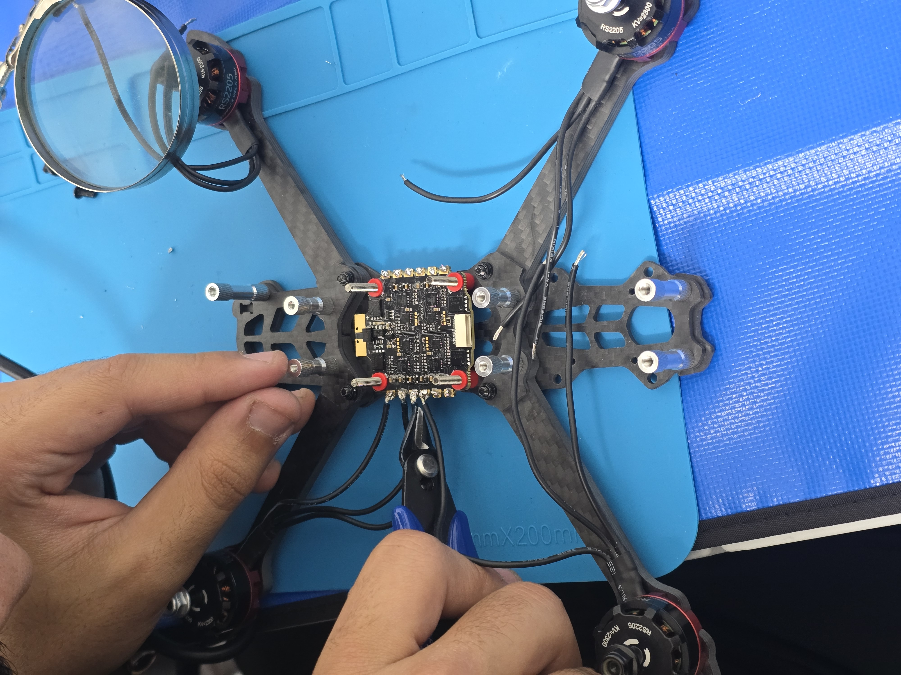
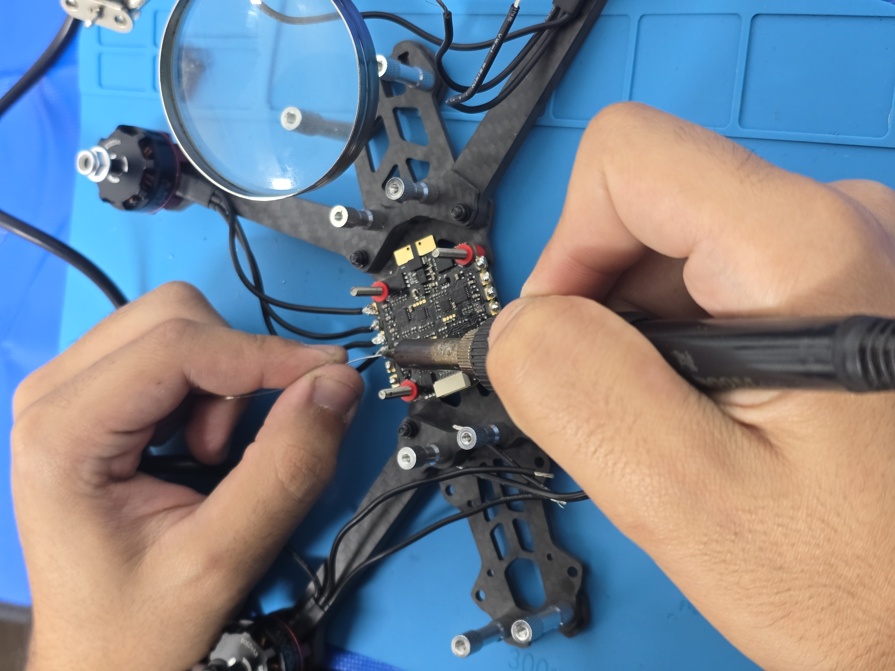
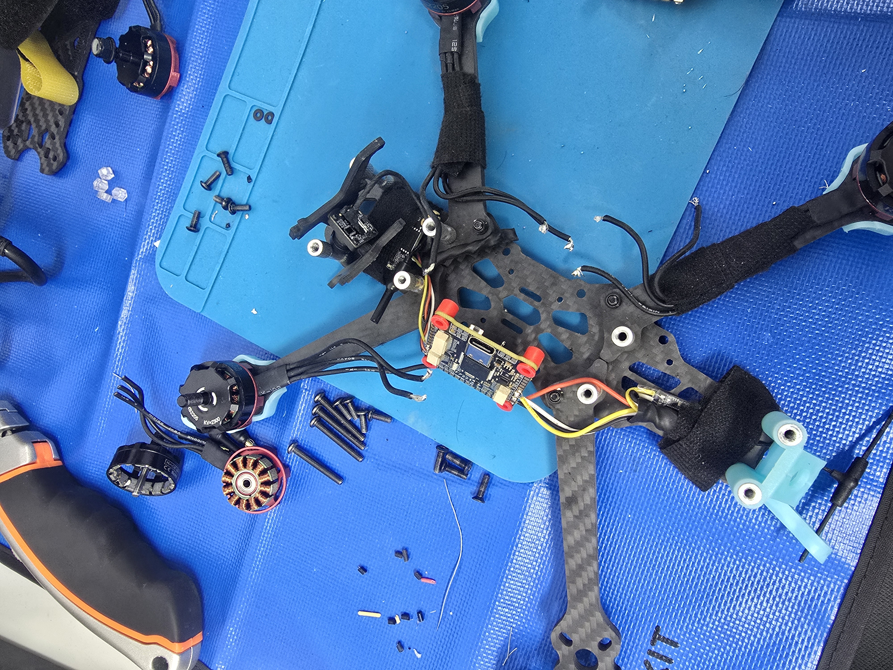
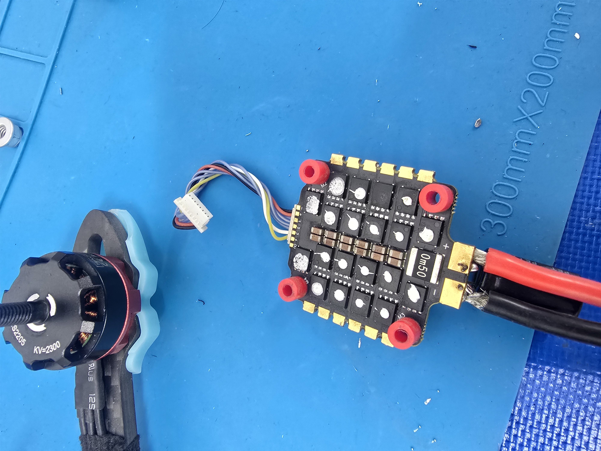
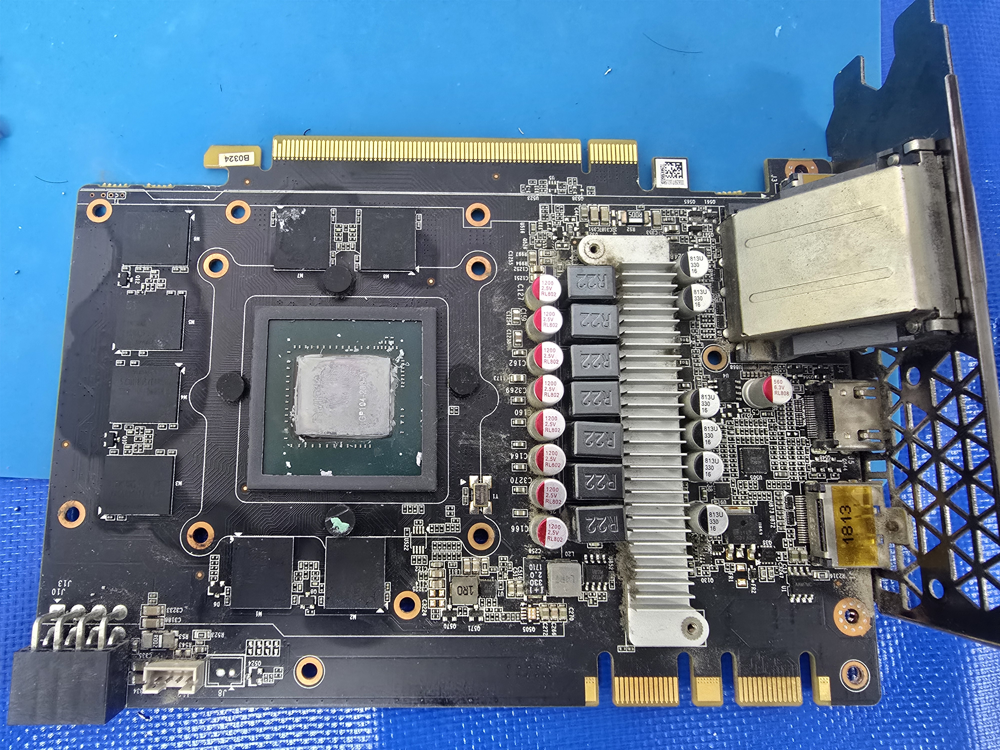
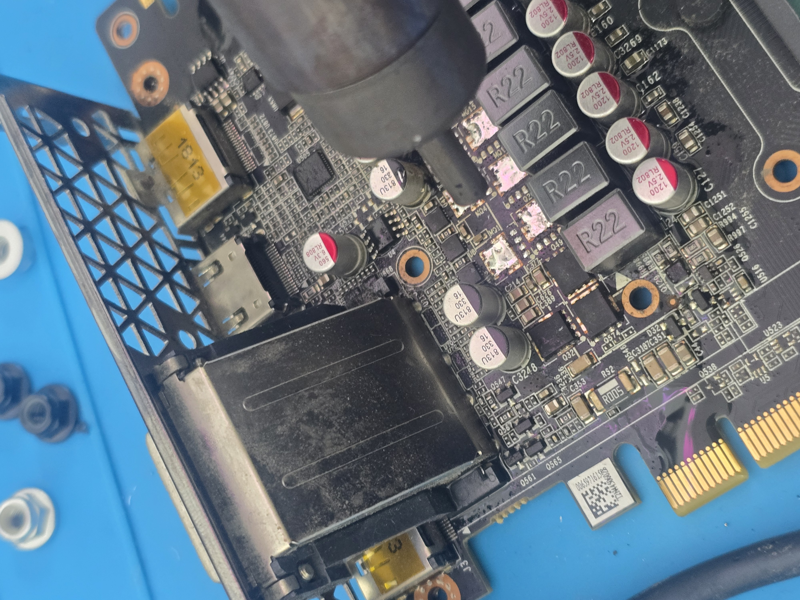

# درون FPV — البناء والإصلاح

> **قيد التطوير.** مشروع شخصي لآدم أبو طعمي.

[English](README.md) · [سجل القطع](docs/HARDWARE.md) · [سجل الإصلاح](docs/REPAIR_LOG.md)

## معرض الميديا

الصور الأصلية الست التي أرسلها آدم. الملفات دون تعديل؛ الصفحة تحدد عرضها فقط.

| التجميع والتوصيلات | تفاصيل البناء |
| --- | --- |
|  |  |
|  |  |
|  |  |

[أسماء الملفات الأصلية](docs/MEDIA_SOURCES.md)

## المشروع ومساهمتي

جمّعت ووصلت درون FPV بقياس 5 إنش، وعملت على إعدادها باستخدام Betaflight وتشخيص مشاكل الإلكترونيات والتشغيل. انتهت تجربة الطيران الأولى بهبوط قاسٍ، ثم عملت على تشخيص ضرر المحرك وESC وأبلغت عن عودة الدرون للعمل بعد الإصلاح. هذه مرحلة سابقة موثقة؛ المشروع ما زال قيد التطوير.

مساهمتي هي التجميع والتوصيل واللحام والإعداد وتشخيص الأعطال. Betaflight برنامج طيران تابع لمطوريه؛ لا يُنسب تطويره إليّ.

## القطع

| القطعة | المؤكد / التفاصيل الناقصة |
| --- | --- |
| الهيكل | Mark4، بقياس 5 إنش |
| البطارية | LiPo ‏4S؛ السعة ومعدل التفريغ غير مؤكدين |
| ESC | ‏60A؛ الموديل والإصدار الدقيقان غير مؤكدين |
| المحركات | Brushless؛ الموديل الحالي وKV غير مؤكدين |
| المراوح | 5 إنش؛ الموديل والخطوة غير مؤكدين |
| التحكم اللاسلكي | مستقبل ExpressLRS وريموت RadioMaster؛ الموديلات الدقيقة غير مؤكدة |
| متحكم الطيران | مستخدم في البناء؛ اسم اللوحة وهدف الفيرموير غير مؤكدين |
| نظام FPV | موجود في البناء الموثق؛ الموديل الدقيق غير مؤكد |
| برامج الإعداد والتدريب | Betaflight وLiftoff |

لم أعتبر اقتراحات الشراء القديمة دليلًا على أن القطع مركبة. [سجل القطع](docs/HARDWARE.md).

## الصعوبات وما حدث

| الصعوبة | العمل الموثق / النتيجة |
| --- | --- |
| اكتشاف الحساس وإعداد الفيرموير | فحوص توصيل وجهد وإعدادات وفيرموير، وعزل بعض التوصيلات أثناء التشخيص |
| فقدان Telemetry مع رفع القدرة أثناء استخدام Smoke Stopper | نوقش هبوط الجهد خلال التشخيص؛ لا يُدّعى حل كل مشاكل التغذية والاتصال نهائيًا |
| هبوط قاسٍ وتضرر محرك | ظهر احتكاك أو تعليق بالمحرك أثناء فحصه، وتبعه تشخيص المحرك وESC |
| قصر في ESC وتلف MOSFET | تشخيص بالملتيميتر، وتركيب MOSFET مشابه مستخرج من GTX 1050 Ti مستعمل؛ أُبلغ عن عودة التشغيل |
| قلة خبرة الطيران | تدريب في Liftoff قبل الرجوع للطيران الفعلي |

لم تُسترجع أرقام MOSFET أو قياسات التوافق أو اختبارات تحمل الإصلاح طويلًا. وصف التجربة ليس دليلًا عامًا لاستبدال المكونات.

## مراحل التطوير

| المرحلة | الحالة |
| --- | --- |
| التجميع والتوصيل واللحام | نُفذت؛ الصور الأصلية أعلاه توثق البناء |
| إعداد Betaflight ونظام FPV | جرى العمل عليهما؛ تصدير الإعداد النهائي غير مرفق |
| تجربة الطيران الأولى | أُبلغ عنها وانتهت بهبوط قاسٍ |
| تشخيص المحرك وESC وإصلاحه | نُفذ؛ أُبلغ عن عودة التشغيل |
| التدريب بالمحاكي ومزيد من الضبط | ضمن التطوير المستمر |
| توثيق الحالة الحالية وأداء الطيران المتكرر وقائمة القطع الكاملة | ما زال مطلوبًا |

## حدود المعلومات الحالية

لا يُدّعى زمن طيران أو مدى أو حمولة مقاسة، ولا جاهزية طيران معتمدة. المستودع يوثق العمل وما بقي منه، والمشروع غير مكتمل.
