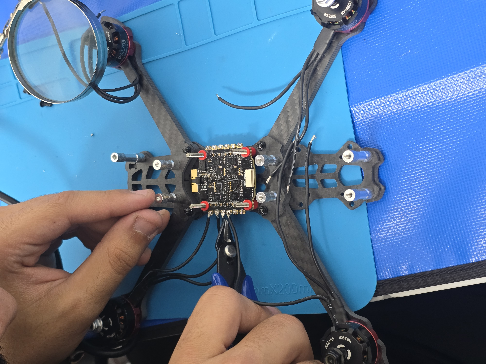
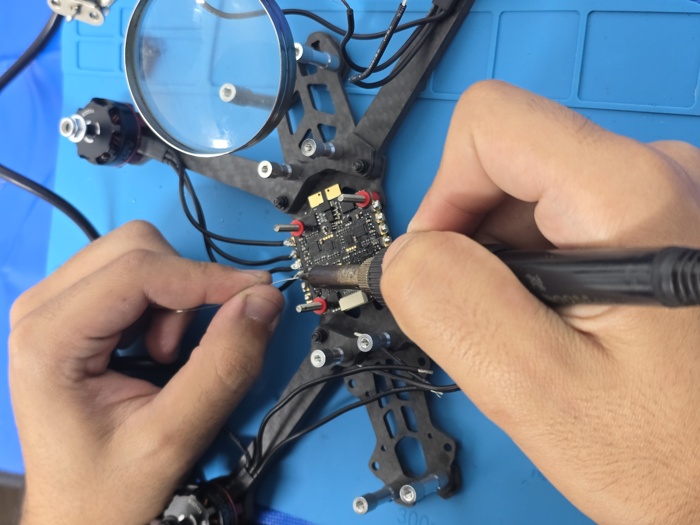
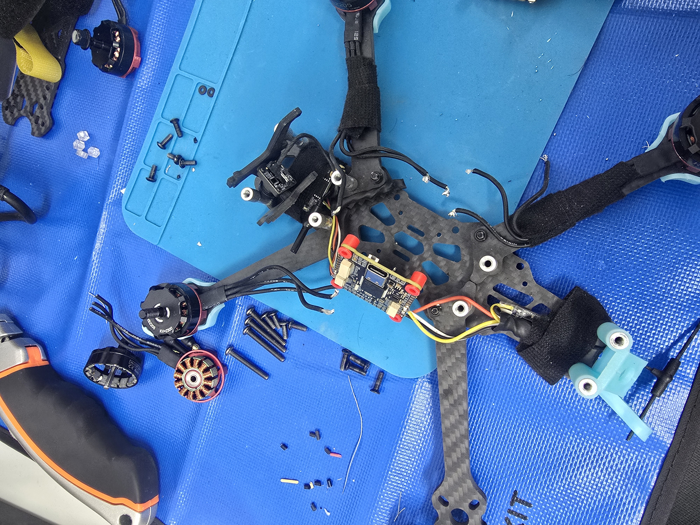
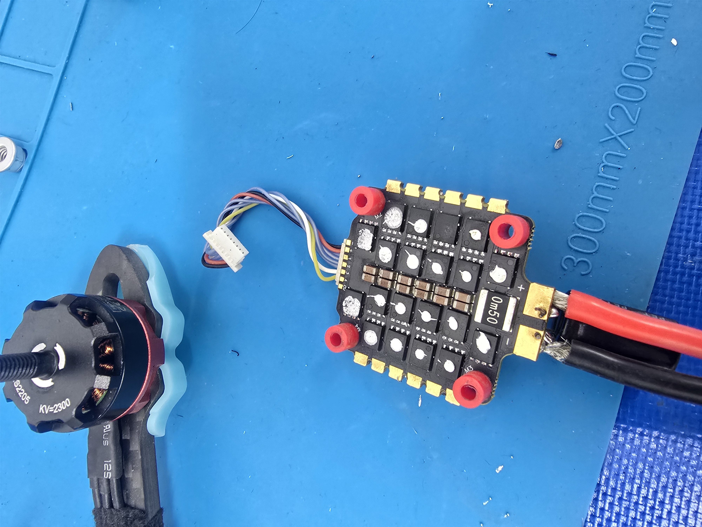
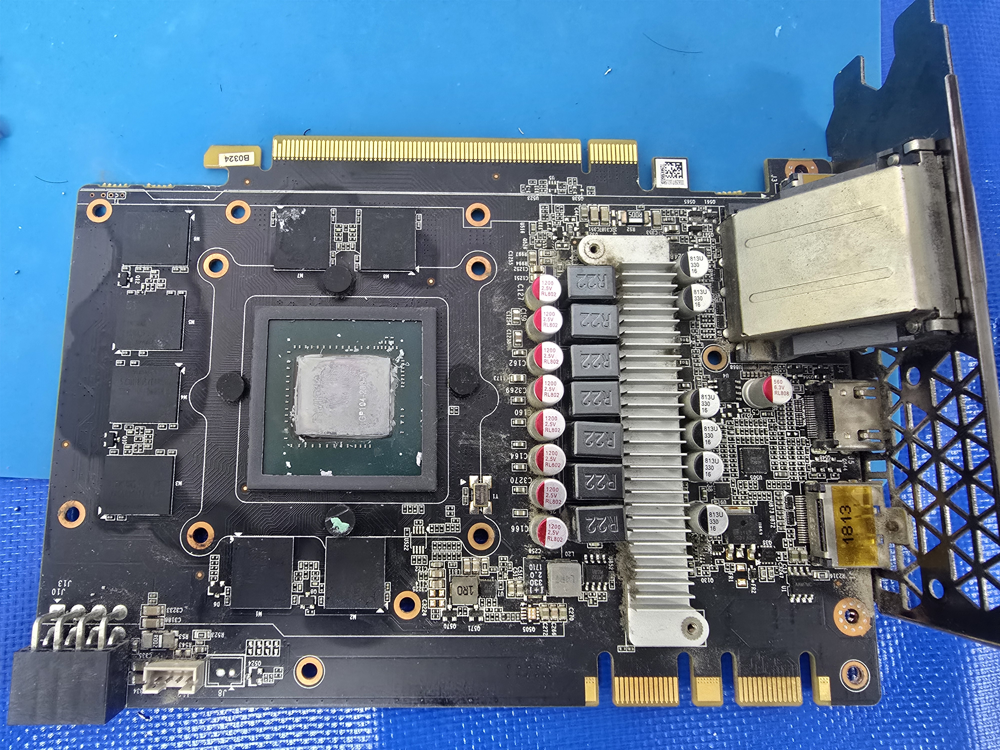
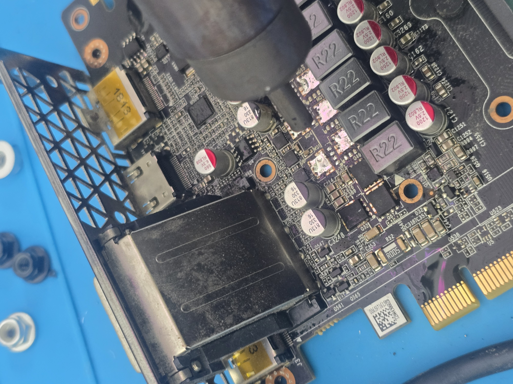

# Original owner-supplied photographs

These six original files were extracted directly from Album 16, part 1. Names and bytes are unchanged. There are no generated pictures, video-frame images, GIFs, or re-encoded videos in this gallery.

| Assembly | Wiring |
| --- | --- |
|  |  |
|  |  |
|  |  |

The project remains work in progress. These historical photographs do not certify present flight readiness or long-term repair reliability. Larger original videos remain in the supplied archive and are not duplicated here.
